# 2 Guys and a Genie: Site Style (current as of Nov 8, 2026)

The live look on 2guysandagenie.com since Nov 7, 2026. Built on the simple daegansmith.me style: Tahoma, black and white, one narrow column, bordered cards. Every new page uses this. Do not use the older style sheets (see "Retired" at the bottom).

## 1. The One Rule

Link the shared style sheet, and nothing else for the base look:

```html
<link rel="stylesheet" href="/assets/simple.css">
```

Page-specific additions go in a small `<style>` block in that page, using the same variables. Copy an existing page as the starting point: `/try-tonight/index.html` (simplest) or `/meetup/index.html` (registration).

## 2. Page Skeleton

```html
<!doctype html>
<html lang="en"><head>
<meta charset="utf-8">
<meta name="viewport" content="width=device-width, initial-scale=1, viewport-fit=cover">
<meta name="color-scheme" content="light">
<title>Page Title · 2 Guys and a Genie</title>
<link rel="icon" type="image/svg+xml" href="/assets/2guys-app-icon.svg">
<link rel="stylesheet" href="/assets/simple.css">
</head><body>
<header class="site"><div class="hwrap">
<a class="brand" href="/">2 Guys and a Genie</a>
<nav class="top"><a class="seat" href="/meetup/">Save my seat</a></nav>
</div></header>
<main id="main">
  <section>
    <p class="kicker">Free · Monday, Nov 9 · 7 to 9pm · Launch Fishers</p>
    <h1>Headline In Title Case.</h1>
    <p>Body copy.</p>
    <a class="btn" href="/meetup/">Save My Seat</a>
  </section>
  <section class="s"> ... next section ... </section>
  <footer>
    <p><a href="/">About 2 Guys and a Genie</a> · <a href="/privacy/">Privacy Policy</a> · <a href="/terms/">Terms</a> · Contact: hello@2guysandagenie.com · This site is not part of Facebook or Meta.</p>
    <p>2 Guys and a Genie is a business name of Reverse Selling Limited Liability Company · 14846 Victory Ct, Carmel, IN 46032</p>
    <p style="font-size:12px;margin:10px 0 0"><a href="/admin/" style="color:#888">Admin</a></p>
  </footer>
</main>
</body></html>
```

Every page ends with that footer, including the small Admin link.

## 3. Colors

Black and white first. One warm highlight. Nothing else unless it's inside a picture.

| Name | Value | Used for |
|---|---|---|
| `--bg` | `#FFFFFF` | Page background |
| `--ink` | `#111111` | Text, borders, black buttons, dark boxes |
| `--soft` | `#555555` | Secondary text, kickers, captions, nav links |
| `--rule` | `#DDDDDD` | Thin dividers between sections, header line |
| Cream | `#FFF3C4` | The only highlight: cream boxes, highlighted words (`.hl`), quote strip, form box |
| `--tint` | `#F4F2EE` | Soft band background (`.band`, `.invited`) |
| `--link` | `#1d3fbf` | Small "go" links inside tiles, the AFTER label |
| `--copper` | `#B5532A` | Small uppercase labels only (`.wc`, `.bring`) |

The home page goes fully black and white by overriding these in its own style block: `--copper`, `--gold` and `--link` set to `#111111`, `--tint` set to `#FFF3C4`. Do the same on any new page that should match the home page exactly. Light mode only (`color-scheme: light`); no dark mode.

## 4. Type

- Font: `Tahoma, Geneva, Verdana, sans-serif` everywhere. No web fonts.
- Body: 19px, line-height 1.6.
- H1: 42px, weight 900, letter-spacing -0.5px, line-height 1.1 (34px on phones under 560px). Long headlines use 38px, line-height 1.15.
- H2: 26px bold, line-height 1.25.
- H3: 20px bold, line-height 1.3.
- Kicker (the small line above a headline): 12px, bold, uppercase, letter-spacing 1px, `--soft`.
- Small text (`.small`): 15px, `--soft`. Captions (`.cap`): 15px, `--soft`.
- Headlines and headings capitalize every word.

## 5. Layout

- One column, max-width 620px, centered. Padding 20px on the sides.
- `main`: padding 52px top, 80px bottom.
- Header: a thin `--rule` line under it; brand mark (28px) plus "2 Guys and a Genie" on the left, one bold underlined "Save my seat" link on the right.
- Sections after the first: `section.s` (40px padding-top, 48px margin-top, 1px `--rule` line on top).
- Written for a phone first. One thought per line where possible; short paragraphs.

## 6. Components (all in simple.css)

- **Buttons:** `.btn` is black with white text, 2px black border, square corners, 17px bold; hover flips to white. `.btn.ghost` is the white version. /meetup also makes buttons full width on phones (in its own style block).
- **Cards:** `.cards` > `a.card` with `.ct` (20px bold title) and `.cd` (16px soft description). 2px black border, no rounded corners. `.card.av` adds a round 72px photo on the left.
- **Wish list:** `.wishes` > `.wish` with `.wt` title, `.wc` small uppercase tag on the right, `.wd` description; hover turns the whole box black.
- **Before-and-after wall:** `.wall` (two columns) > `.tile` with image on top (16:10, cropped to the top) and a short label; `.tile.dark` is the black call-to-action tile. Tiles open the before-and-after window (`#ba-modal`).
- **Quotes:** `.quote` has a 4px black left border, the words, then `.who` in bold with a `small` line under it for the business.
- **Video:** `.vid` is a 16:9 box with a 4px black border; `.vid-cap` under it.
- **Doodles:** `.doodle` is the marker-drawing image with a 2px black border, `.cap` under it.
- **Three-up facts:** `.three` (three bordered boxes, stacks on phones). **Results:** `.result` (two bordered boxes with a big number).
- **Choices:** `.roads` > `.road`; `.road.pick` is the black chosen one.
- **FAQ:** `details` / `summary`, thin rule between.
- **Steps:** `ol.steps`, or `.try` boxes with a `.num` square number.
- **Highlighted words:** `<span class="hl">` gives the cream marker look. Use on results and payoffs only, a handful per page.
- **Registration:** `.seatbox` (3px black border) holds the GoHighLevel form; `.seatbox .form` is the cream box around it; `.sms-disclosure` is the 13px consent text under it.
- **Page-level extras on /meetup** (copy from that page if needed): `.cream` (cream box with a black left border), `.bringbox` (black box, white text), `.vidcard` (black video card with play circle), `.venue` (bordered photo of the venue).

## 7. Rules That Go With The Look

- Square corners everywhere (the only rounded things are the phone mockups inside pictures: text threads, lock screens).
- Borders are black: 2px for cards and tiles, 3 to 4px for the big boxes (seat box, video, quotes).
- No drop shadows, no gradients, no color photos used as backgrounds.
- No exit pop-ups.
- Name AI, ChatGPT and Claude plainly. The genie is the nickname, never a stand-in.
- Every "work with us" link points to the registration page, /meetup.
- Rotating spots (headline, pictures, quotes) use `/assets/rot.js` so each visitor keeps one version and the scoreboard can count it. A new rotating spot needs its name added to `NAMES` in `stats/worker.js`.
- The GoHighLevel form, consent wording and Meta pixel are copied exactly from /meetup; don't retype them.

## 8. Files

- `/assets/simple.css`: the shared style sheet (the source of truth for everything above).
- `/assets/2g-mark.svg`: the header mark. `/assets/2guys-app-icon.svg`: the favicon.
- `/assets/doodles/`: the marker doodles.
- `/assets/rot.js`: rotations and the scoreboard counter. `/assets/ba.js`: the before-and-after window.

## 9. Retired: Don't Use On New Pages

- `/assets/genie.css`, `/assets/genie-components.css`, `/assets/genie.js`: the old dark "Genie Engine" look (midnight navy, gold, line art).
- `/assets/kit-c.css` with the Archivo web font: an earlier kit, still on /jamon until that page is moved over.

They stay in the repo so old and archived pages don't break.
